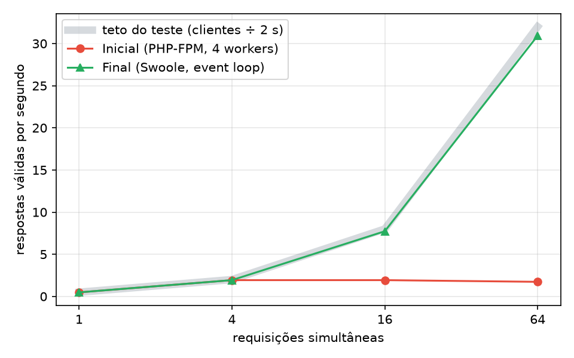
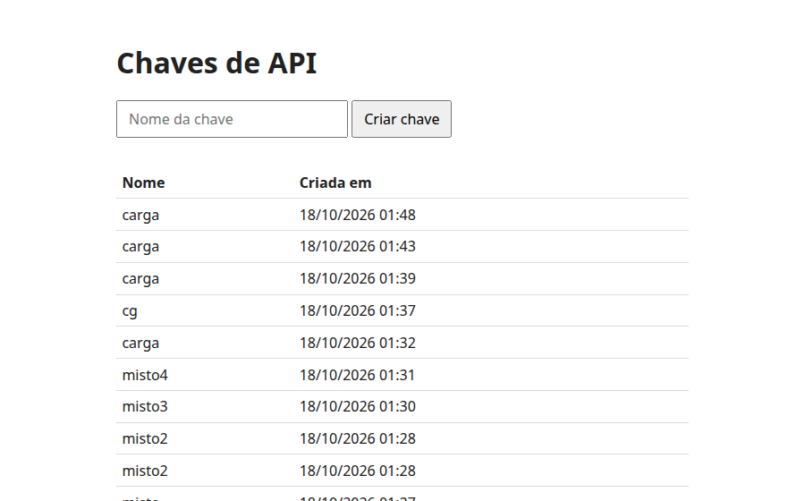
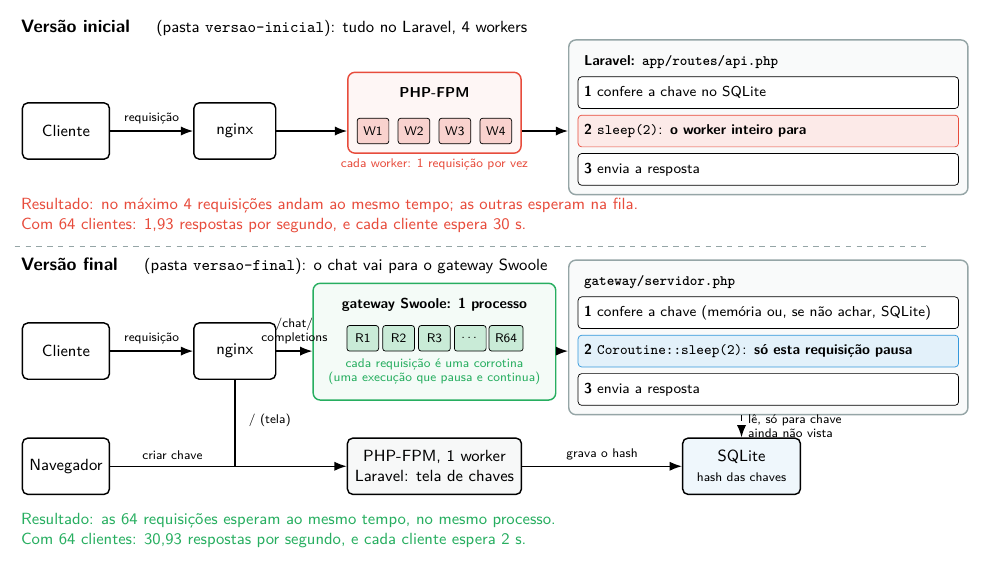
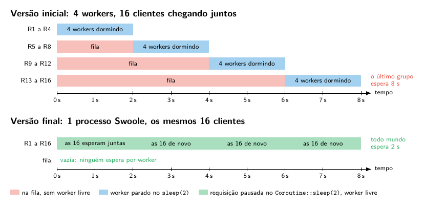
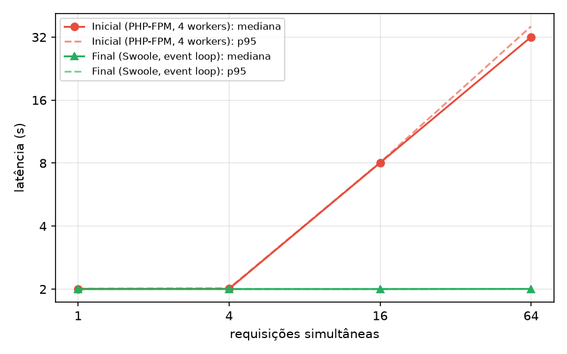

# AI Gateway (desafio F2AI)

`POST /chat/completions` autenticado por chave de API, com resposta fictícia depois de 2 s, dentro de 1 vCPU, 512 MB e 4 workers.

A solução é toda em PHP. O Laravel faz o cadastro de chaves, como o enunciado pede, e o `/chat/completions` roda num servidor PHP com Swoole, porque no Laravel cada worker atende uma requisição por vez. A justificativa de cada escolha está em [Decisões](#decisões).



## Estrutura

```
app/              Laravel: a tela de chaves e o endpoint da versão inicial (com sleep(2))
gateway/          servidor Swoole: o endpoint da versão final
docker/           Dockerfile do Laravel e script de início, usados pelas duas versões
versao-inicial/   docker-compose.yml, nginx.conf e php-fpm.conf da versão inicial
versao-final/     docker-compose.yml, nginx.conf e php-fpm.conf da versão final
carga/            testes de carga, resumo e gráficos
resultados/       números medidos e imagens
```

As duas versões usam o mesmo código; muda só a configuração de cada pasta.

## Como rodar

```sh
cd versao-final            # ou versao-inicial (uma de cada vez: as duas usam a porta 8080)
docker compose up -d --build
```

Criar uma chave pela tela, em http://localhost:8080, ou pelo terminal (dentro da pasta da versão):

```sh
docker compose exec -u www-data laravel php artisan chave:criar minha
```



Testar o endpoint:

```sh
curl -X POST localhost:8080/chat/completions \
  -H "Authorization: Bearer <chave>" -H "Content-Type: application/json" \
  -d '{"messages":[{"role":"user","content":"oi"}]}'
```

Testes:

```sh
gateway/teste.sh     # versão final no ar: 200, 401, 422, 405 e a chave depois de reiniciar
docker run --rm -v "$PWD/app:/app" -w /app composer:2 sh -c "composer install -q && vendor/bin/phpunit"   # Laravel
```

## Como funciona

### O caminho de uma requisição



1. O cliente manda `POST /chat/completions` com a chave. O nginx recebe a conexão.
2. **Versão inicial:** o nginx passa a requisição a um dos 4 workers do PHP-FPM, que roda o Laravel (`app/routes/api.php`). O worker confere a chave, executa `sleep(2)` e responde. Durante esses 2 s ele fica parado e não atende mais ninguém; quem chega depois espera na fila.
3. **Versão final:** o nginx passa a requisição ao gateway Swoole (`gateway/servidor.php`), que a atende numa corrotina (uma execução de função que pode pausar e continuar depois). Ele confere a chave, executa `Coroutine::sleep(2)` e responde. Durante esses 2 s, só aquela requisição fica pausada; o processo continua atendendo as outras.
4. Nas duas versões, a tela de chaves é o Laravel no PHP-FPM. Ele grava o hash da chave no SQLite, e o gateway lê dali.

### A espera no tempo, com 16 clientes



Na versão inicial, só 4 requisições andam ao mesmo tempo (uma por worker), e as outras 12 ficam na fila: o último grupo espera 8 s. Na versão final, as 16 esperam juntas no mesmo processo, e todas recebem a resposta em 2 s.

### Configuração de cada versão

| | Versão inicial | Versão final |
|---|---|---|
| Tela de chaves | Laravel no PHP-FPM | Laravel no PHP-FPM |
| `/chat/completions` | Laravel no PHP-FPM, `sleep(2)` (`app/routes/api.php`) | Swoole, `Coroutine::sleep(2)` (`gateway/servidor.php`) |
| Workers | 4 do PHP-FPM | 1 do PHP-FPM + 1 do gateway |
| CPU (soma = 1 vCPU) | nginx 0,1 · Laravel 0,9 | nginx 0,4 · Laravel 0,1 · gateway 0,5 |
| Memória (soma = 512 MB) | nginx 64 · Laravel 448 | nginx 64 · Laravel 96 · gateway 352 |

Todos os serviços ficam no núcleo 0. Na versão final, o nginx manda `/chat/completions` para o gateway e o resto para o Laravel. As chaves ficam num SQLite em volume do Docker: o Laravel grava e o gateway lê.

## Medição

Com a versão no ar:

```sh
carga/rodar.sh final       # ou inicial: 1, 4, 16 e 64 clientes, 60 s cada
python3 carga/graficos.py  # gráficos (precisa de matplotlib)
```

- **Ferramenta**: k6 1.3.0 em Docker, nos núcleos 1 a 3, para não disputar CPU com a solução.
- **Carga**: cada cliente manda uma requisição, espera a resposta e manda a próxima (`constant-vus`).
- **Válida**: só resposta 200. Timeout do cliente: 60 s. Só conta o que termina dentro dos 60 s, e há 35 s de pausa antes de cada cenário para a fila do anterior esvaziar.
- **CPU**: tempo de CPU que o kernel contou para os contêineres da versão (cgroup), somado e dividido pelos 60 s; 100% = 1 núcleo. O `docker stats` arredonda para 0% nessa carga, por isso não serve aqui.
- **Memória**: `docker stats` a cada 2 s, mais ou menos, somando os contêineres.
- **Máquina**: AMD Ryzen 5 8600G (12 threads), 32 GB, Linux 7.0, Docker 29.4.

Resultados completos em `resultados/inicial` e `resultados/final`.

### Versão inicial

| simultâneas | válidas/s | mediana | p95 | erros | timeouts | CPU média | memória média / pico |
|---:|---:|---:|---:|---:|---:|---:|---:|
| 1 | 0.48 | 2.01 s | 2.01 s | 0 | 0 | 0.29% | 36 / 38 MiB |
| 4 | 1.93 | 2.01 s | 2.02 s | 0 | 0 | 0.76% | 36 / 37 MiB |
| 16 | 1.93 | 8.02 s | 8.06 s | 0 | 0 | 0.80% | 37 / 38 MiB |
| 64 | 1.93 | 30.16 s | 32.15 s | 0 | 0 | 0.78% | 38 / 40 MiB |

### Versão final

| simultâneas | válidas/s | mediana | p95 | erros | timeouts | CPU média | memória média / pico |
|---:|---:|---:|---:|---:|---:|---:|---:|
| 1 | 0.48 | 2.00 s | 2.00 s | 0 | 0 | 0.03% | 41 / 42 MiB |
| 4 | 1.93 | 2.00 s | 2.00 s | 0 | 0 | 0.05% | 42 / 42 MiB |
| 16 | 7.73 | 2.00 s | 2.00 s | 0 | 0 | 0.14% | 42 / 44 MiB |
| 64 | 30.93 | 2.00 s | 2.01 s | 0 | 0 | 0.48% | 46 / 47 MiB |



### Autenticação sob carga

`carga/misto.js`: 64 clientes por 60 s na versão final, metade com chave inválida.

```sh
CHAVE=$(cd versao-final && docker compose exec -T -u www-data laravel php artisan chave:criar misto)
docker run --rm --network host --cpuset-cpus 1-3 -v "$PWD/carga:/carga" -e CHAVE=$CHAVE grafana/k6:1.3.0 run /carga/misto.js
```

| clientes | respostas certas | por segundo | erradas |
|---|---:|---:|---:|
| 32 com chave válida (esperado: 200) | 896 | 14.9 | 0 |
| 32 com chave inválida (esperado: 401) | 32890 | 548 | 0 |

Toda chave inválida foi recusada. As válidas ficam um pouco abaixo do teto de 16 por segundo porque as inválidas, sem espera, chegam a mais de 500 por segundo e ocupam a CPU do nginx.

## Gargalo, tentativas e limite

- **Gargalo**: na versão inicial, o `sleep(2)` prende o worker os 2 s inteiros. Com 4 workers, saem no máximo 4 respostas a cada 2 s (2 por segundo), e o resto vira fila: com 64 clientes, a latência chega a 30 s. A CPU fica abaixo de 1%; o limite não é processamento, é worker parado.
- **O que tentei**: mais workers e threads não são permitidos (contam no limite de 4). Descartei o Laravel Octane sem rodar: ele usa o Swoole, mas desliga as corrotinas (`'enable_coroutine' => false` em `src/Commands/StartSwooleCommand.php`, versão 2.22), então cada worker continua atendendo uma requisição por vez. O ganho veio de não prender o worker na espera: o gateway em Swoole faz a espera numa corrotina e, enquanto ela dorme, atende as outras requisições. Um processo só dá conta, porque com 1 vCPU mais processos não somam CPU. No teste com chaves inválidas, o nginx travou nos 0,1 vCPU que tinha; passei para 0,4 e o gateway para 0,5.
- **O que melhorou**: com 64 clientes, de 1,93 para 30,93 respostas válidas por segundo (16 vezes), e a latência mediana de 30 s para 2 s. A CPU por resposta caiu junto: a versão inicial gastou 0,78% de um núcleo para 1,9 respostas por segundo; a final, 0,48% para 31.
- **Limite que permaneceu**: o próprio teste. Cada cliente espera 2 s por resposta, então a vazão máxima é clientes ÷ 2 s (32 por segundo com 64 clientes), e a versão final fica nesse teto em todos os cenários. Os números ficam um pouco abaixo porque as primeiras respostas só chegam depois de 2 s e o que está em andamento no segundo 60 é cortado. Acima disso, o primeiro limite real que apareceu foi a CPU do nginx: no teste com chaves inválidas, a mais de 500 requisições por segundo, ele chegou aos 0,4 vCPU dele.

## Decisões

### Arquitetura

| Decisão | Por quê |
|---|---|
| Laravel no PHP-FPM para a tela de chaves | o enunciado exige Laravel no cadastro; PHP-FPM é o jeito padrão de rodar Laravel, e a tela é pouco usada, então não precisa de nada além disso |
| `/chat/completions` fora do Laravel, num servidor Swoole (`gateway/servidor.php`) | o gargalo é o worker parado durante a espera de 2 s. O Swoole faz a espera numa corrotina (uma função que pausa e continua depois) e, enquanto ela dorme, o mesmo processo atende outras requisições. No PHP-FPM, cada processo atende uma requisição por vez, e o limite de 4 workers trava a vazão em 2 por segundo |
| Não usar o Laravel Octane | ele roda o Laravel no Swoole, mas desliga as corrotinas (`'enable_coroutine' => false` em `src/Commands/StartSwooleCommand.php`, versão 2.22), então cada worker continua atendendo uma requisição por vez |
| Não ligar as corrotinas do Octane à força | o Laravel guarda estado global no processo (a requisição atual, o usuário, a configuração). Com duas requisições pausadas no mesmo processo, uma pode pegar os dados da outra |
| 1 processo no gateway | com 1 vCPU, mais processos não somam CPU; um event loop já usa o núcleo inteiro, e com 64 clientes o gateway usou menos de 0,5% |
| nginx na frente | o PHP-FPM não fala HTTP; o nginx recebe as conexões e manda `/chat/completions` para o gateway e o resto para o Laravel |
| Uma aplicação e duas pastas de configuração | as duas versões rodam o mesmo código; a diferença entre elas fica visível em três arquivos pequenos (`docker-compose.yml`, `nginx.conf`, `php-fpm.conf`). Na versão final, a rota de chat do Laravel continua no código, mas o nginx nunca a alcança (`location /chat/` devolve 404) |

### Chaves e autenticação

| Decisão | Por quê |
|---|---|
| SQLite num volume do Docker | não roda processo extra nem gasta memória do limite de 512 MB; a chave sobrevive ao reinício; há poucas escritas (criar chave) e muitas leituras |
| Só o hash SHA-256 da chave no banco | se o banco vazar, ninguém usa as chaves. A chave tem 192 bits aleatórios, então não dá para adivinhar e não precisa de um hash lento como o bcrypt, que a 32 verificações por segundo passaria do vCPU inteiro |
| Chave mostrada uma vez só | o banco só tem o hash, então a chave não pode ser recuperada depois |
| Chaves válidas em memória no gateway | o banco só é consultado para uma chave ainda não vista; assim uma chave criada agora vale na hora, sem reiniciar |
| Chaves inválidas não ficam em memória | quem manda chaves aleatórias faria a memória crescer sem limite; consultar o SQLite aguentou mais de 500 recusas por segundo |
| Só a requisição válida espera | chave errada recebe 401, corpo sem `messages` recebe 422 e método que não é POST recebe 405, na hora, sem ocupar nada por 2 s |
| Sessão do Laravel num cookie cifrado | a chave recém-criada passa para a tela pela sessão; no cookie, cifrada com a `APP_KEY`, ela não fica gravada no banco |
| `APP_KEY` gerada ao iniciar o contêiner | o Laravel exige uma; gerar no início evita deixar segredo no repositório |

### Limites e medição

| Decisão | Por quê |
|---|---|
| CPU e memória divididas entre os serviços, somando 1 vCPU e 512 MB | o enunciado limita o conjunto; o Docker Compose não tem limite compartilhado, então cada serviço tem uma parte e a soma fecha o total |
| nginx com 0,4 vCPU na versão final | com 0,1, ele travou no teste com chaves inválidas (mais de 500 requisições por segundo); o gateway usa pouco e ficou com 0,5 |
| Todos os serviços no núcleo 0; o k6 nos núcleos 1 a 3 | a solução se comporta como 1 vCPU de verdade, e o gerador de carga não rouba CPU dela |
| Workers: 4 do PHP-FPM na inicial; 1 do PHP-FPM e 1 do gateway na final | é o limite do enunciado. O mestre do PHP-FPM só gerencia os filhos e o nginx só repassa conexões; mesmo contando o nginx, a final tem 3 |
| k6 com clientes em laço fechado | cada cliente manda, espera a resposta e manda a próxima: é o "1, 4, 16 e 64 requisições simultâneas" do enunciado |
| Só conta o que termina dentro dos 60 s, com 35 s de pausa antes de cada cenário | o k6 seguia contando respostas depois do fim, e a fila de um cenário da versão inicial atrasava o seguinte; os dois inflavam ou derrubavam os números |
| CPU pelo cgroup, não pelo `docker stats` | o `docker stats` arredonda para 0% nessa carga; o cgroup é o tempo exato que o kernel contou para cada contêiner |

## Uso de IA

Usei ferramentas de IA na escrita do código, dos testes de carga e da documentação. Revisei, executei e validei todas as partes.
